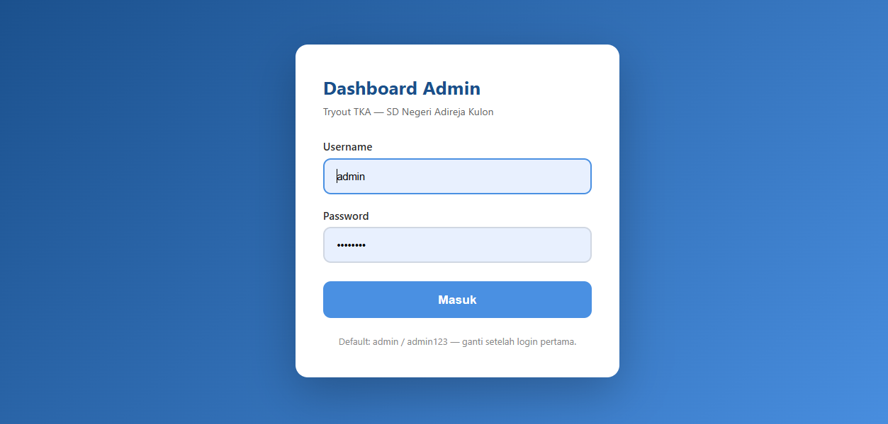
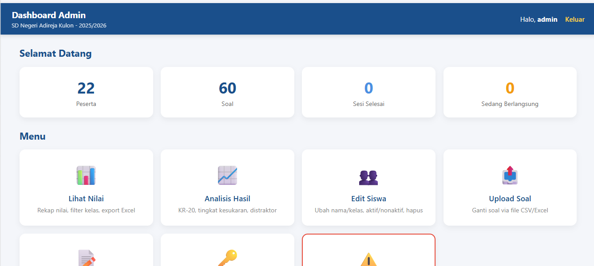
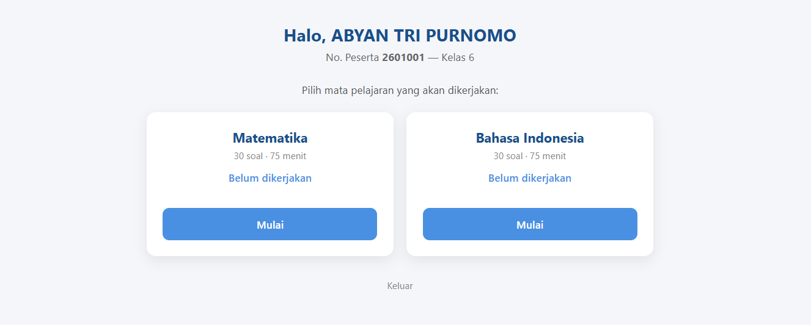
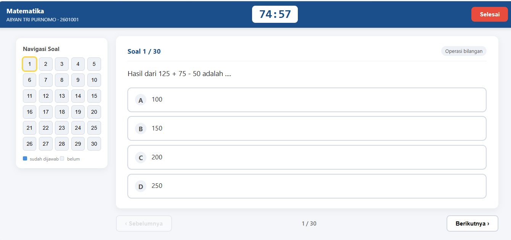

# 🎓 Tryout TKA v2 — Sistem Ujian Berbasis LAN (Offline)

**Sistem ujian tryout offline berbasis web untuk Sekolah Dasar.**

Dirancang khusus untuk lingkungan tanpa internet (LAN), berjalan menggunakan XAMPP, dan mendukung pengamanan ujian menggunakan **Safe Exam Browser (SEB)**. Dilengkapi analitik butir soal otomatis, meliputi KR-20, daya beda, tingkat kesukaran, dan analisis distraktor.

<div align="center">


</div>

---

## 🖼️ Tampilan Aplikasi

### 1. Dashboard Admin

Dashboard terpusat untuk admin sekolah, dilengkapi pemantauan peserta, status sesi ujian, manajemen soal, dan analisis hasil ujian.

<p align="center">
  
  &nbsp;
  
</p>

### 2. Antarmuka Siswa

Antarmuka yang bersih dan mudah digunakan. Siswa masuk menggunakan nomor peserta dan token, memilih mata pelajaran, kemudian mengerjakan soal melalui navigasi yang intuitif.

<p align="center">
  
  &nbsp;
  
</p>

---

## 🌟 Fitur Unggulan

### 🛡️ 1. Keamanan dan Anti-Kecurangan

- **Safe Exam Browser (SEB):** Mendukung penggunaan SEB dalam mode kiosk untuk membatasi akses siswa ke aplikasi lain selama ujian, sesuai konfigurasi perangkat.
- **Server-Side Timer:** Waktu ujian dihitung berdasarkan waktu server agar tidak bergantung pada jam perangkat siswa.
- **Pembatasan Antarmuka:** Pembatasan klik kanan, tombol refresh, pintasan pengembang, dan pencetakan melalui browser.
- **Token Unik:** Autentikasi peserta menggunakan nomor peserta dan token acak enam digit.

> **Catatan keamanan:** Pembatasan melalui JavaScript atau browser biasa tidak dapat menjamin pemblokiran seluruh pintasan sistem operasi. Gunakan SEB dengan konfigurasi yang sesuai dan lakukan pengujian keamanan sebelum ujian berlangsung.

### 📝 2. Modul Ujian Lengkap

- **Dua Sesi Ujian:** Matematika dan Bahasa Indonesia, masing-masing dirancang untuk 30 soal.
- **Durasi Fleksibel:** Waktu pengerjaan 75 menit per mata pelajaran.
- **Jeda Otomatis:** Jeda lima menit antarsesi jika diaktifkan dalam konfigurasi.
- **Autosave Jawaban:** Jawaban disimpan secara berkala atau setiap perubahan melalui server sesuai implementasi aplikasi.
- **Dukungan Gambar:** Soal dapat memuat gambar untuk denah, geometri, grafik, dan ilustrasi lainnya.

### 📊 3. Analitik dan Evaluasi Butir Soal

Analisis hasil ujian tersedia melalui dashboard admin tanpa memerlukan aplikasi analisis tambahan.

| Indikator | Fungsi |
|---|---|
| Tingkat Kesukaran (*p-value*) | Mengukur proporsi peserta yang menjawab soal dengan benar. |
| Daya Beda (*Point-Biserial*) | Mengukur hubungan antara jawaban suatu butir soal dan skor keseluruhan peserta. |
| Reliabilitas (KR-20) | Mengukur konsistensi internal tes dengan skor butir dikotomis. |
| Analisis Distraktor | Mengevaluasi pilihan jawaban A, B, C, dan D, termasuk efektivitas pengecoh. |

### 🛠️ 4. Manajemen Admin Mandiri

- **Impor Soal Massal:** Impor soal melalui CSV atau format lain yang didukung, termasuk referensi gambar.
- **Manajemen Peserta:** Tambah, edit, dan kelola data peserta.
- **Manajemen Token:** Buat atau reset token peserta.
- **Reset Data Ujian:** Kelola data ujian lama untuk pelaksanaan tryout berikutnya.
- **Ekspor Nilai:** Unduh rekap hasil ujian dalam format Excel `.xlsx`.

---

## 🏗️ Arsitektur Sistem

Sistem dirancang agar ringan dan portabel untuk sekolah dengan infrastruktur terbatas.

```text
                    JARINGAN LOKAL (LAN)

+---------------------------+
|        PC SISWA           |
|---------------------------|
| Safe Exam Browser (SEB)   |
| - Antarmuka ujian         |
| - Mode kiosk              |
| - Pembatasan akses        |
+-------------+-------------+
              |
              | HTTP melalui LAN
              |
              v
+--------------------------------------------+
|           SERVER WINDOWS                   |
|--------------------------------------------|
| XAMPP                                      |
| - Apache                                   |
| - PHP 8.2                                  |
| - MariaDB                                  |
|                                            |
| Aplikasi:                                  |
| - /tka/          : Antarmuka siswa         |
| - /tka-admin/    : Dashboard admin         |
|                                            |
| Database: tka                              |
| Python 3.12: Opsional untuk analitik       |
+--------------------------------------------+
```

### 🧰 Teknologi yang Digunakan

- **Sistem Operasi:** Windows.
- **Web Server:** Apache melalui XAMPP.
- **Backend:** PHP 8.2.
- **Database:** MariaDB.
- **Browser Ujian:** Safe Exam Browser.
- **Analitik Opsional:** Python 3.12.

> Nama folder, versi perangkat lunak, database, dan modul di atas menggambarkan rancangan proyek. Pastikan semuanya sesuai dengan implementasi aktual.

---

## 🚀 Instalasi dan Penggunaan

1. Instal XAMPP pada komputer server Windows.
2. Tempatkan file aplikasi pada direktori web, misalnya `C:\xampp\htdocs\tka\`.
3. Buat database `tka` melalui phpMyAdmin atau jalankan skrip SQL yang disediakan proyek.
4. Sesuaikan konfigurasi koneksi database dengan kredensial lokal.
5. Jalankan Apache dan MariaDB melalui XAMPP Control Panel.
6. Akses aplikasi dari komputer server menggunakan `http://localhost/tka/`.
7. Untuk komputer siswa, gunakan alamat IP server melalui jaringan LAN, misalnya `http://192.168.1.10/tka/`.
8. Konfigurasikan Safe Exam Browser sesuai kebutuhan dan uji alur ujian sebelum digunakan.

**Penting:** Langkah di atas merupakan panduan umum. Sesuaikan dengan struktur folder, skrip database, dan konfigurasi yang benar-benar tersedia dalam proyek.

---

## 🤝 Kontribusi dan Dukungan

Proyek ini dikembangkan untuk mendukung kemajuan pendidikan dasar di Indonesia.

Kontribusi berupa laporan bug, usulan fitur, pengujian, dokumentasi, maupun pengembangan kode sangat terbuka.

### 💖 Support dan Donasi

Jika sistem ini bermanfaat bagi sekolah Anda dan ingin mendukung pengembangan fitur berikutnya, silakan gunakan QRIS berikut.

<p align="center">
  
</p>

### 📞 Kontak Developer

**BLACK CUBE CODE**  
*Solusi Teknologi Pendidikan Terjangkau*

- **Telegram:** [@blackcubecodeadmin](https://t.me/blackcubecodeadmin)
- **GitHub Issues:** [Laporkan Bug atau Ajukan Fitur](https://github.com/blackcubecode/tryout-tka-v2/issues)

---

## 📄 Lisensi

Proyek ini didistribusikan di bawah **MIT License**.

Lihat file [`LICENSE`](LICENSE) untuk informasi selengkapnya.
